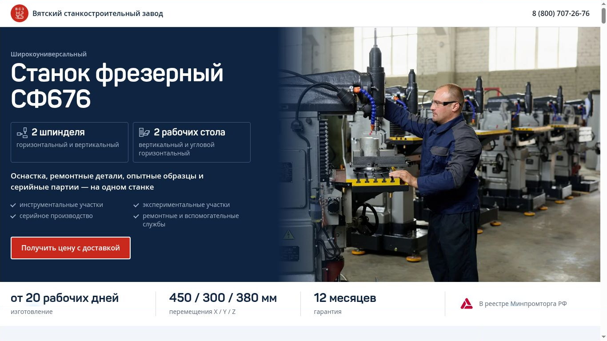

# СФ676 · Итерация 07. Первый экран

За основу взята опубликованная итерация 06, [коммит `97efbee`](https://github.com/volkov43-beep/sf676/commit/97efbee25b5b0f5f26349df9839c7302e61ba7a3). Ветка `feature/sf676-hero-07`.

## Композиция и тексты

Шапка видна при загрузке и занимает место в потоке страницы. В начале страницы справа доступен телефон. Когда основная кнопка полностью проходит за нижнюю границу закреплённой шапки, рядом с телефоном появляется «Получить цену». При возвращении к основной кнопке дубликат скрывается. На коротком мобильном экране до первой прокрутки основная кнопка может находиться ниже сгиба. Обе кнопки открывают согласованный сценарий запроса цены. Высоту шапки для якорей передаёт существующая переменная `--sticky-height`.

Слева на сплошном синем размещены утверждённые тексты. В текстовой колонке 41 слово и число, с полосой фактов — 58. Посчитаны группы букв и цифр, включая X, Y и Z. Сохранены все дословно заданные строки. Для двух схем добавлены компактные варианты в существующий SVG-спрайт. У больших исходных схем при уменьшении до 26 px толщина штриха составляла бы около 0,22 px. В малых вариантах она составляет около 1,5 px. На телефонах фото выше текста, факты образуют сетку 2 × 2. На 360 px схемы помещаются рядом, список применений занимает одну колонку.

## Фотография и кадрирование

Из исходного JPEG 2048 × 1365 получены четыре WebP. Сохранены направление съёмки, детали станка и заводские таблички. Фото занимает 64% ширины десктопной сцены, на телефоне и планшете — всю ширину. Предзагрузка и `img` используют одинаковые списки ресурсов и `sizes`. Для основного изображения заданы размеры, высокий приоритет загрузки и заранее зарезервированное место. В браузере при загрузке зарегистрирован один запрос выбранной версии фотографии.

| Режим | Настройка | Обоснование |
| --- | --- | --- |
| От 901 px | `object-fit: cover`, `object-position: 38% 47%` | При обрезке краёв остаются шпиндель с заготовкой и оператор. Первые 16% области фото закрыты сплошным navy, на 34% градиент заканчивается. Текстовая колонка заканчивается до начала перехода. |
| До 900 px | `object-position: 50% 46%`, высота `min(60vw, 38svh)` | Сохранена рабочая зона между фрезой и руками оператора. Нижние 26% высоты фото плавно переходят в navy. Текст начинается после изображения. |

Для градиента использован один и тот же navy с непрозрачностью от единицы до нуля. Кадрирование проверено по изображению и по координатам шпинделя, детали, лица и руки в отрисованном кадре.

| Ресурс | Размер в пикселях | Размер файла |
| --- | --- | ---: |
| `sf676-operator-800.webp` | 800 × 533 | 60 582 Б |
| `sf676-operator-1200.webp` | 1200 × 800 | 116 052 Б |
| `sf676-operator-1600.webp` | 1600 × 1066 | 174 944 Б |
| `sf676-operator-2000.webp` | 2000 × 1333 | 291 948 Б |
| `minpromtorg-72.png` | 72 × 72 | 2 586 Б |
| `minpromtorg-144.png` | 144 × 143 | 5 311 Б |

**Знак Минпромторга.** По уточнению заказчика использован приложенный малиновый знак `#C90237` на белом фоне. Он показан шириной 36 px с пустым alt рядом с надписью «В реестре Минпромторга РФ». Обе версии сохраняют исходные пропорции с округлением до целого пикселя.

**Прежняя фотография.** В разделе «Ключевые преимущества СФ676» под описанием двух шпинделей можно раскрыть «СФ676 на производственном участке ВСЗ». Это существующий в карточках способ просмотра фотографий. Использованы прежние квадратные и портретные WebP с исходным alt. [Открытая карточка](screenshots/after-1366-machine.jpg).

## Проверка размеров

Chrome, Linux. Каждый снимок показывает полный указанный viewport от начала страницы. Нижняя граница полосы фактов измерена от верха viewport. При целевых размерах 1366 × 768 и 1440 × 900 она выше нижнего края окна. Для ширин без заданной высоты выбраны 1024 × 768, 768 × 1024 и 320 × 568.

| Viewport | Высота шапки | Низ полосы фактов | До | После |
| --- | ---: | ---: | --- | --- |
| 1920 × 1080 | 61 px | 886 px | [До](screenshots/before-1920.jpg) | [После](screenshots/after-1920.jpg) |
| 1440 × 900 | 61 px | 767 px | [До](screenshots/before-1440.jpg) | [После](screenshots/after-1440.jpg) |
| 1366 × 768 | 61 px | 734 px | [До](screenshots/before-1366.jpg) | [После](screenshots/after-1366.jpg) |
| 1024 × 768 | 61 px | 681 px | [До](screenshots/before-1024.jpg) | [После](screenshots/after-1024.jpg) |
| 768 × 1024 | 61 px | 1023 px | [До](screenshots/before-768.jpg) | [После](screenshots/after-768.jpg) |
| 390 × 844 | 57 px | 1053 px | [До](screenshots/before-390.jpg) | [После](screenshots/after-390.jpg) |
| 320 × 568 | 57 px | 1123 px | [До](screenshots/before-320.jpg) | [После](screenshots/after-320.jpg) |

На всех семи размерах ширина документа совпала с доступной шириной, переполнения шапки и первого экрана не обнаружено. Дополнительно проверены 360 и 901 px. На 320 и 390 px название завода набрано в две строки. При прокрутке название, звонок и кнопка располагаются в одной строке шапки. [Шапка на 320 px](screenshots/after-320-scroll.jpg) · [390 px](screenshots/after-390-scroll.jpg) · [1366 px](screenshots/after-1366-scroll.jpg).

В отдельном браузерном прогоне для 320, 390, 1366, 1440 и 1920 px проверены загрузка, видимость дублирующей кнопки в двух пикселях с обеих сторон порога, обратная прокрутка и открытие формы из обеих кнопок. На четырёх размерах суммарный сдвиг макета (CLS) при загрузке равен 0, на 390 px — 0,000096. Это лабораторные измерения одной среды.

## Контраст

Коэффициент рассчитан по относительной яркости sRGB. Для обычного текста применяется порог 4,5:1, для видимых границ управления и значимой графики — 3:1. Значения ниже округлены до сотых. [WCAG 2.2, контраст текста](https://www.w3.org/WAI/WCAG22/Understanding/contrast-minimum.html) · [контраст графики и контролов](https://www.w3.org/WAI/WCAG22/Understanding/non-text-contrast.html).

| Применение | Цвета | Коэффициент | Оценка |
| --- | --- | ---: | --- |
| Заголовки, предложение, белая рамка CTA на синем, название завода и крупные факты на белом | #FFFFFF / #0F2440 | 15,59:1 | Проходит |
| Надзаголовок, пояснения карточек, пиктограммы и галочки | #A9B8CC / #0F2440 | 7,73:1 | Проходит |
| Текст основной кнопки и кнопки шапки | #FFFFFF / #C9281D | 5,52:1 | Проходит |
| Текст CTA при наведении и нажатии | #FFFFFF / #A81F17 | 7,31:1 | Проходит |
| Подписи на полосе фактов | #5A6779 / #FFFFFF | 5,75:1 | Проходит |
| Телефон | #1B2430 / #FFFFFF | 15,65:1 | Проходит |
| Фокус основной кнопки на синей панели | #FFBF47 / #0F2440 | 9,50:1 | Проходит |
| Фокус ссылки или кнопки в белой шапке | #8A6D00 / #FFFFFF | 4,92:1 | Проходит |
| Рисунок знака Минпромторга | #C90237 / #FFFFFF | 5,92:1 | Фирменный знак |
| Обводка статичных карточек | #3D5A85 / #0F2440 | 2,23:1 | Декоративная граница. Текст и пиктограммы передают всю информацию. |
| Разделители фактов | #D5DCE6 / #FFFFFF | 1,38:1 | Декоративная линия между подписанными фактами. |

## Сохранность и проектные проверки

Исходная проверка `tests/verify-preservation.py` сохранена. На полной паре HTML её обычный режим ожидаемо обнаруживает изменение изображения. Адаптер `tests/verify-hero-preservation.py` отдельно сверяет утверждённые тексты, исходные атрибуты CTA, переехавшее фото и responsive preload. Затем сверяет DOM за пределами перечисленных исключений и вызывает прежний скрипт на общей части. Контрольная подмена текста другой секции отклонена.

1. В `#top` разрешены утверждённый текст, новая композиция, фото оператора, знак Минпромторга и ссылки на компактные пиктограммы. В head добавлена только предзагрузка фотографии.
2. В шапке разрешены название рядом с логотипом и начальное скрытие кнопки. В inline JS изменены только измерение шапки и переключение этой кнопки при прокрутке, изменении размеров и переходе по якорю.
3. В `#advantages` разрешено только перенесённое фото с раскрываемой прежней подписью. У него сохранены файлы, srcset, alt и размеры. Обновлены sizes, приоритет и режим загрузки по новому месту.
4. В inline CSS обновлены правила первого экрана, шапки и перенесённого фото. В SVG-спрайт добавлены два символа, все прежние символы сверены отдельно.

Остальные тексты, таблицы, порядок секций, `data-q`, метаданные, восемь ссылок заявок на `#order`, JS форм, калькулятора, подбора и карты сверены с базовой версией. Исходные фотографии сохранены. Локально пройдены команды `pr-checks.yml` — проверка JS, компиляция Python, 20 тестов Node, реестр 90 точек поставок и резервный список, статическая сборка и побайтовое сравнение assets.

**Что осталось.** Из двух доступных вложений использованы фотография и согласованный знак. Отдельный файл схемы-референса не был приложен, поэтому композиция собрана по тексту задания. Обязательные проверки выполнены. Следующий шаг — визуальное согласование PR.
